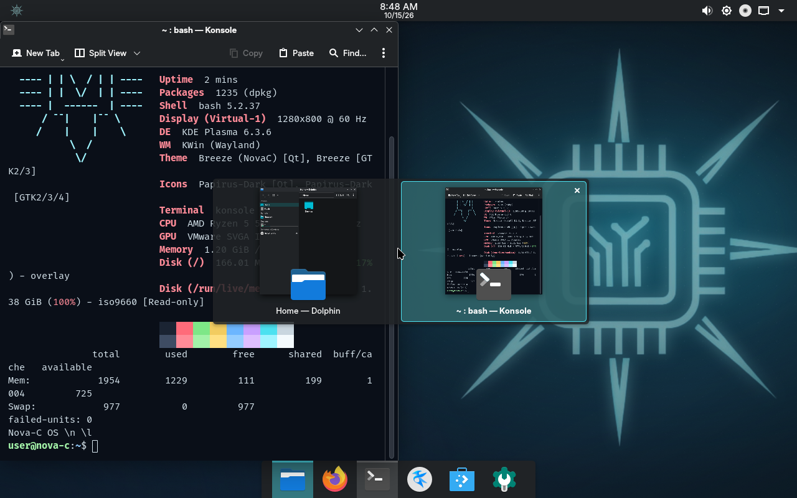
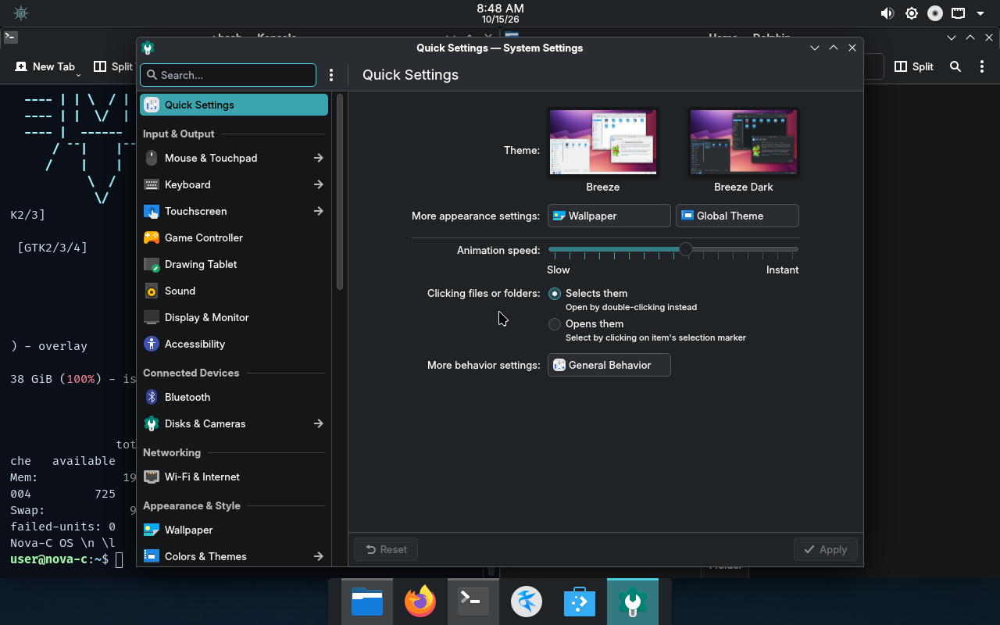
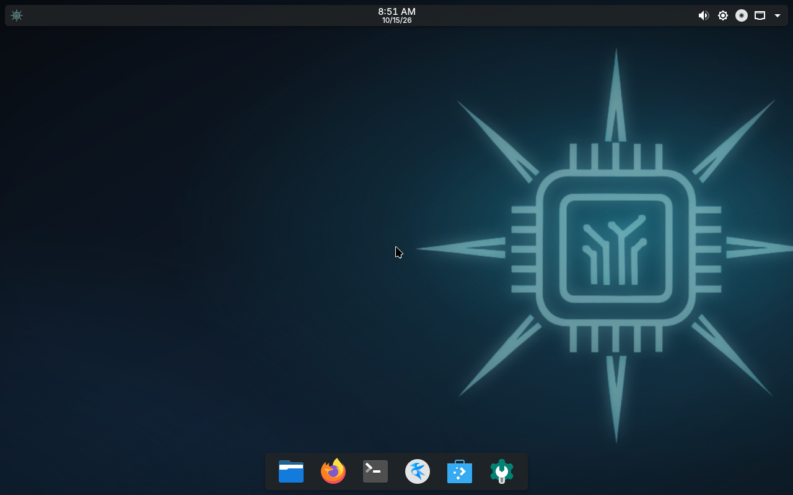
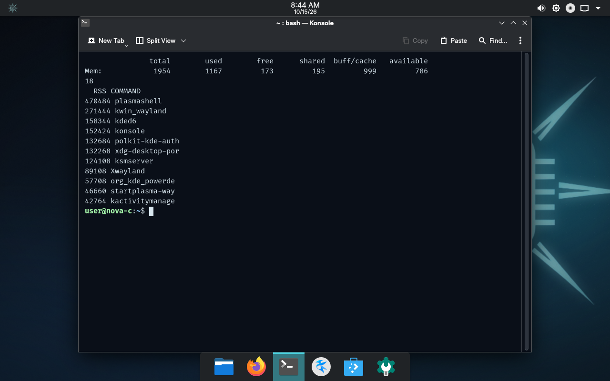

# Nova-C OS: status and test report

## 0.2.0: lighter, faster to start, nicer to look at

Tested on 15 Oct 2026 in VirtualBox 7.2 (Windows 10 host, Ryzen 5 5500), laptop-style VM: 2 vCPU, 2 GB RAM, 1280x800, no 3D (software
rendering), UEFI. Everything below was produced by scripts in this repository, run on the ISOs themselves: 0.1.3 (`novac-0.1.3.iso`, 1,751,285,760 bytes)
against 0.2.0 (`novac.iso`, 1,478,590,464 bytes, sha256 `378eb51e20ef7f080ebbcceef58d6c1dd12321e4615213f0410d3454da5c7794`).

### Results

| Measurement | 0.1.3 | 0.2.0 | How |
|---|---|---|---|
| ISO, everyday edition | 1.75 GB | 1.48 GB (-16%) | file size |
| ISO, Craft edition | 2.26 GB | 2.02 GB (-11%) | file size |
| Enter in the boot menu to a finished desktop | 41.9 s, 41.9 s | 30.7 s, 32.4 s (Craft: 30.4 s) | `scripts\measure-boot.ps1`, two runs each |
| Start of userspace to `graphical.target` | 9.7 s | 5.1 s | `systemd-analyze` ([old](screenshots/30-boot-analysis-0.1.3.png), [new](screenshots/31-boot-analysis-0.2.0.png)) |
| `ldconfig.service` on the critical path | 6.0 s | gone | same |
| `live-config.service` | 5.9 s | 2.0 s | same |
| Kernel and initramfs | 5.1 s | 4.1 s | same |
| Initramfs the boot loader reads | 153 MB | 69 MB | file size in `/live` |
| Memory in use, idle desktop, one terminal | 1191 MB (762 MB available) | 1167 MB (786 MB available) | `free -m` ([old](screenshots/32-memory-0.1.3.png), [new](screenshots/33-memory-0.2.0.png)) |

`measure-boot.ps1` watches VirtualBox screenshots: it presses Enter one second after the menu shows, and calls the desktop "finished" at the first
frame after which every frame stays close to the last frame of the run. Both ISOs are measured the same way in the same VM (the firmware starts at
1280x800 and the virtual SATA controller has 2 ports: VirtualBox's default of 30 made the kernel probe 28 empty links for about 15 s, a test-rig
artifact that would have hidden most of the differences).

### What changed

| Area | Change |
|---|---|
| Boot time | Image stamped so systemd does not re-run `ldconfig`/hwdb at every boot; live locale generated at build time and the time-zone step skipped; zstd squashfs; initramfs without AMD/NVIDIA/Radeon/Xe drivers and firmware (`/usr/share/initramfs-tools/hooks/zz-nova-c-slim`); quiet kernel line (`loglevel=3 nowatchdog`, no shutdown prompt); shorter systemd timeouts; empty-session login (no restore of the previous session's windows) |
| Idle RAM and processes | The Discover update notifier, accessibility daemon and X11 tray/menu proxies are really off now (they were started by systemd's autostart generator even though their files had been renamed); installer removed from the installed system |
| Image size | `dpkg` rules skip docs, man pages, stock wallpapers and translations outside 23 languages; on-screen keyboard moved to the opt-in `nova-c-touch` package; legacy server and USB-dongle firmware dropped |
| Boot menu | 16:9 themed GRUB menu at the firmware's native mode (was a fixed 800x600), Inter typeface, selection pill, boots by itself after 5 s; the installed system gets the same theme, a 3 s timeout and `gfxpayload=keep` |
| Boot splash | Fade-in, breathing halo, progress bar that glides; redraws a third as often because the old animation cost about 7 s of boot on a software-rendered screen |
| Desktop look | Inter as the UI font, Fira Code in terminals; three wallpapers with film grain against banding; cyan Papirus folders; Nova-C terminal palette; window shadows and outlines; floating top bar; animations 25% quicker; Firefox without first-run tours, compact, hardware video decoding on |

### Checks

| # | Check | Result | Evidence |
|---|---|---|---|
| 1 | Themed boot menu, correct text, Inter font, 5 s auto-boot | PASS |  |
| 2 | Boot splash with halo and progress bar | PASS |  |
| 3 | Boots to the desktop (autologin), floating top bar, dock, wallpaper | PASS |  |
| 4 | Launcher, Inter UI font, cyan accent | PASS |  |
| 5 | Terminal palette; fastfetch shows Nova-C OS 0.2.0, Plasma 6.3.6, Wayland, 0 failed units | PASS |  |
| 6 | Snap tiling, Dolphin with cyan folders | PASS |  |
| 7 | Alt+Tab, System Settings (animation speed slider is at the new default) | PASS |   |
| 8 | Firefox opens straight to a new tab: no welcome tour, compact toolbar | PASS |  |
| 9 | Login screen (autologin off) and login with the live password | PASS |   |
| 10 | Plasma helpers off: no DiscoverNotifier, kaccess or xembedsniproxy in the process list | PASS |  |
| 11 | Installed-system GRUB menu: `grub-mkconfig` in the image finds the Nova-C theme, loads the fonts, uses a 3 s timeout and the quiet command line | PASS (generated offline in the image, not booted) | |
| 12 | Upgrade 0.1.3 to 0.2.0 on an installed system: old diversions undone, Discover notifier moved out of the autostart directory, helpers masked, folder icons recoloured, initramfs rebuilt slim, `dpkg --audit` clean | PASS (clean copy of the image, not a VM) | |
| 13 | Full install with Calamares, then boot of the installed system | **NOT DONE** | see below |

### Limits and open items (please read)

- **No real hardware.** Every number is from the VM. Real laptops have faster storage and GPUs but also firmware time; the *differences* (6 s of `ldconfig`, 85 MB of drivers in the boot files) should carry over, the totals will not.
- **AMD and NVIDIA graphics** are no longer in the boot files. They load from the system image a moment later (the usual `MODULES=dep` behaviour). The Intel and virtual GPUs of the VM stayed in, so this path was **not exercised**. Please report a black screen or a missing splash on such a laptop.
- **The Calamares install was not repeated on 0.2.0.** The VirtualBox guests froze intermittently on this host while the installer scanned disks (the same freeze happened with the 0.1.3 ISO, so it is the test rig, not the image). The parts of the installed system that changed were checked in other ways (checks 11 and 12), and `scripts\run-install-test.ps1` is there to repeat the install by hand.
- **A dark gap of a few seconds** remains between the boot splash and the login splash (the display server starting); it is longer in the VM because of software rendering.
- The touchscreen on-screen keyboard is now opt-in (`sudo apt install nova-c-touch`): untested on a real convertible such as the Akoya E3216.
- Languages outside the kept list show English; the list is in `/etc/dpkg/dpkg.cfg.d/90-nova-c-lean`.

---

<details>
<summary>Original 0.1 test report</summary>

> **Note (0.1.3):** this report covers the first Plasma build (0.1). Since then the installer, automatic updates,
> Hardware Drivers, boot/login splash and the Craft edition were added and tested in VMs; see the
> [README](../README.md) and screenshots 10–27. Several "limits" below are now resolved (there is an installer).
> The screenshots 01–09 were re-taken on a later build, so they can show a newer version than this text.

Build under test: `output/novac.iso`, **1520 MB**, sha256 `1b08c07c3b9da792f12ca3b65dd171fdc7b5a98d5b6135730346b6988d673d7b`.
Tested on 13 Oct 2026 in VirtualBox 7.2.20 (Windows 10 host, Ryzen 5 5500). Everything below was run by
[`scripts/run-ui-tests.ps1`](../scripts/run-ui-tests.ps1) on that exact ISO; screenshots are in `docs/screenshots/`.

## What it is now

| | |
|---|---|
| Base | Debian 13 "trixie", Linux 6.12.111, 1169 packages in the live image |
| Desktop | KDE Plasma 6.3.6 on KWin (Wayland), SDDM login manager |
| Look | Custom `org.novac.desktop` look-and-feel: NovaC colour scheme (deep slate, cyan accent from the logo), Papirus-Dark icons, thin top bar (launcher with the Nova-C logo, clock, tray) and a floating bottom dock (Dolphin, Firefox ESR, Konsole, Kate, Discover, System Settings) |
| Branding | Boot menu and splash, desktop and login wallpaper, `os-release` ("Nova-C OS 0.1, based on Debian GNU/Linux 13"), ISO label `NOVA_C_OS`, hostname `nova-c`, fastfetch greeting with the Nova-C logo |
| Target | Laptops with mouse/touchpad + keyboard first; touchscreens second (on-screen keyboard is configured for touch, see limits) |

Direction change during this session: the first prototype used Phosh (a phone shell). You asked for the look of the two reference screenshots
and said laptops are the main target, so the desktop is now Plasma 6 with a custom theme.

## Test report (laptop mode: mouse + keyboard, no touch; VM 2 GB RAM, 2 vCPU, 1280x800)

| # | Check | Result | Evidence |
|---|---|---|---|
| 1 | Boot menu (UEFI GRUB), branding, correct text | PASS |  |
| 2 | Boots to the desktop with autologin, no lock screen | PASS |  |
| 3 | Launcher menu opens with the Meta key; favourites; user shows as "Nova-C live user" | PASS |  |
| 4 | Terminal via Ctrl+Alt+T; fastfetch shows Nova-C OS, Plasma 6.3.6, KWin (Wayland), theme NovaC, 0 failed systemd units | PASS |  |
| 5 | Window management: Meta+Left / Meta+Right tiling, launching Dolphin from the dock with Meta+1 | PASS |  |
| 6 | Alt+Tab window switcher with thumbnails | PASS |  |
| 7 | System Settings opens (Meta+6); Mouse & Touchpad, Keyboard, Touchscreen, Display, Bluetooth and Wi-Fi pages present | PASS |  |
| 8 | SDDM login screen (autologin disabled): wallpaper, clock, user, password field, Sleep/Restart/Shut Down | PASS |  |
| 9 | Login with the live password lands on the desktop | PASS |  |
| 10 | No on-screen keyboard appears while a hardware keyboard is in use (login screen, desktop, focused search field in Settings) | PASS | screenshots 07, 08, 09 |

Measured in the VM (screenshot 04): **1251 MB used, 703 MB available** of 1954 MB with one terminal open; 13 MB swap used.
This includes the live session's RAM-backed overlay and software rendering, so it overstates what an installed system on real hardware needs.

## Problems found and fixed while testing

| Problem | Cause | Fix |
|---|---|---|
| No login possible, desktop never started | live-config only creates the live user when `user-setup` is installed; it is only a Recommends and the build turns recommends off | added `user-setup` |
| Missing runtime pieces (`chvt`, session bus, audio realtime, Mesa/EGL libs) | same: Recommends dropped | listed explicitly (`kbd`, `dbus-user-session`, `rtkit`, `upower`, Mesa packages) |
| Phosh could not start without GPU 3D | VirtualBox without 3D has no EGL | (prototype only) software-renderer fallback script. Plasma's KWin runs on Mesa's software OpenGL in the same VM without any special handling |
| Phone-sized 720x1440 screen | Debian's `phoc.ini` forced VirtualBox's output to a phone mode | moot after the switch to Plasma |
| fastfetch/system said "Debian" | `/etc/os-release` was a plain file, not the symlink the branding hook edited | hook now replaces it with a symlink |
| Splash said "Debian GNU/Linux 0.1" | splash template read the version from our own `os-release` | template text fixed |
| Build failed offline | `firmware-linux` pulled in `firmware-b43-installer`, which downloads firmware from GitHub during the build; live-build's `firmware-chroot` did the same | explicit firmware list, `--firmware-chroot false`; also made the ISO about 140 MB smaller |
| Test scripts failed on VirtualBox progress output | PowerShell treated stderr as fatal | scripts fixed |

## Limits and untested areas (please read)

- **Mouse clicks are untested.** VirtualBox cannot inject mouse clicks from the command line, so the run uses keyboard shortcuts. The pointer is visible and moves, but clicking the dock or menu items with a mouse was not exercised.
- **Touchpad and touchscreen are untested.** The VM has no touchpad. The on-screen keyboard (maliit) is wired into KWin for touch use, but no touch events were sent. Tap-to-click defaults on a real touchpad are not verified.
- **No real hardware yet.** Wi-Fi, Bluetooth, audio, suspend/resume, battery, brightness keys, HiDPI scaling and GPU drivers were not tested. The VM runs with 3D off (software rendering), so the GPU path is untested; try `scripts\test-vbox.ps1 -Accel3d`, and boot the ISO from a USB stick on a spare laptop.
- **Memory:** a 2 GB machine is tight with Plasma (see numbers above). 4 GB or more is a comfortable target; this is heavier than the Phosh prototype, which is the cost of the Plasma look.
- **Live ISO only.** There is no installer yet (Calamares is the next step). The live user is `user` with password `live`, with autologin. Do not treat the live session as secure.
- **Firmware is an explicit list** (Intel, AMD, NVIDIA graphics; Intel, Realtek, Atheros, MediaTek, Broadcom FullMAC, Libertas, TI Wi-Fi; SOF audio; CPU microcode). Old Broadcom b43 Wi-Fi chips and server NIC firmware are not included.
- Secure Boot, ARM64 and 32-bit UEFI tablets are untested or unsupported (amd64 only).
- Firefox, Kate, Discover and Flatpak were not launched in this run.

## How to reproduce

```bash
wsl -d Debian -u root -- bash scripts/build.sh                  # builds output/novac.iso
```

```powershell
powershell -File scripts\test-vbox.ps1                          # boot it in a laptop-style VM
powershell -File scripts\run-ui-tests.ps1                       # repeat this report's tests and screenshots
```

## Suggested next steps

1. Boot the ISO from USB on a real laptop and note what breaks (the quirks list from RESEARCH.md starts there).
2. Add the Calamares installer so it can be installed, not just run live.
3. Test the GPU path (`-Accel3d`) and try to trim idle RAM (disable Baloo/Discover notifier, review autostart).
4. Decide on optional extras. A separate opt-in variant with the Craft app suite is being prepared in another session; it is not part of this ISO.

</details>
